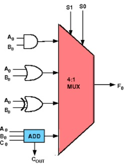

### 1-bit Programmable ALU

#### Circuit Diagram

_Figure 1: 1-bit Programmable ALU circuit diagram showing multiplexer-based function selection with arithmetic and logic components. Reference: Theory section_

#### Components Required

- 1 Full Adder
- 1 AND gate
- 1 OR gate
- 1 XOR gate
- 1 4-to-1 Multiplexer

#### Circuit Connections

The board has the input bits A, B, cin, S1 and S0, and the output bits Output (the result F) and cout. An input bit can be connected to several components: drag a new wire from an output point that is already connected. A wire can be dragged from an output point to an input point or the other way round.

1. **Full Adder Setup**: Drag the full adder and connect the input bits A and B to its pins A0 and B0 respectively, and connect the input bit cin to its Cin pin. This will handle the arithmetic addition operation when selected.

2. **Logic Gates Setup**: Drag AND, OR, and XOR gates and connect the input bits A and B to their input pins. These gates will perform the logical operations when selected by the multiplexer.

3. **Carry Output Connection**: Connect the Cout pin (carry output) of the full adder to the cout output bit. This provides the carry signal for arithmetic operations.

4. **Multiplexer Configuration**: Drag a 4-to-1 multiplexer and connect its select pins s1 and s0 to the input bits S1 and S0 respectively.

5. **Multiplexer Input Connections** (refer to the demo for visual guidance with labeled inputs):

   - Connect i0 of multiplexer to the "Sum" output of the full adder (for addition operation - selected when S₁S₀ = 00)
   - Connect i1 of multiplexer to the output of the AND gate (for AND operation - selected when S₁S₀ = 01)
   - Connect i2 of multiplexer to the output of the OR gate (for OR operation - selected when S₁S₀ = 10)
   - Connect i3 of multiplexer to the output of the XOR gate (for XOR operation - selected when S₁S₀ = 11)

6. **Output Connection**: Connect the output of the multiplexer to the Output bit.

7. **Testing**: Set the values of A, B, cin, S1, and S0 by clicking on the input bits (each click toggles the bit between 1 and 0) and click "Simulate".

**Note**: The demo visualization includes enhanced MUX input labels (I₀(00), I₁(01), I₂(10), I₃(11)) with colored backgrounds to help you understand which operation is selected by each S₁S₀ combination.

#### ALU Function Table

| S₁  | S₀  | Operation | Description                                                  |
| --- | --- | --------- | ------------------------------------------------------------ |
| 0   | 0   | Addition  | Output = sum bit of A + B + Cin, cout = carry of A + B + Cin |
| 0   | 1   | AND       | Output = A · B                                               |
| 1   | 0   | OR        | Output = A + B                                               |
| 1   | 1   | XOR       | Output = A ⊕ B                                               |

#### Testing Procedures

**Addition Operation (S₁S₀ = 00):**

1. Set S₁ = 0, S₀ = 0 to select addition mode
2. Test various combinations of A, B, and cin inputs
3. Observe both the Output (Sum) and the carry output (cout)
4. Verify results match full adder truth table

**Logic Operations (S₁S₀ = 01, 10, 11):**

1. Set appropriate S₁S₀ combinations for AND, OR, or XOR operations
2. Test with different A and B input combinations
3. Observe output matches the selected logical operation
4. Note that the cin input is not used for logic operations

#### Observations

- **Function Selection**: The multiplexer selects which operation result appears at the output based on S₁S₀ control signals, as described in the theory section. The demo visualization shows labeled MUX inputs (I₀(00), I₁(01), I₂(10), I₃(11)) to clarify this selection process.

- **Arithmetic Mode**: When S₁S₀ = 00, the ALU performs addition of A, B, and cin, producing both Sum and Carry outputs for potential cascading to higher-order bits.

- **Logic Modes**: When S₁S₀ = 01, 10, or 11, the ALU performs AND, OR, or XOR operations respectively, with the Carry output being irrelevant for these operations. For this reason the truth table shown on "Submit" checks cout only when S₁S₀ = 00 and shows it as x (don't care) for the other select codes.

- **Control Signal Behavior**: The S₁S₀ control signals act as a simple instruction set, determining which arithmetic or logical operation the ALU executes.

- **Visual Learning Aid**: The enhanced demo includes colored background labels for MUX inputs, making it easier to understand the relationship between control signals and selected operations.

- **Success Verification**: If the circuit has been constructed correctly as described above, a "Success" message will be displayed upon clicking the "Submit" button.

#### Circuit Building Guidelines

- **Component Placement**: Arrange components logically with inputs on the left, processing elements in the middle, and outputs on the right for clear signal flow visualization.

- **Wire Management**: Use clean, direct connections between components to avoid crossing wires and maintain circuit readability.

- **Input Testing**: Systematically test all possible input combinations for each operation mode to verify correct ALU functionality.

- **Signal Verification**: Double-check that control signals S₁S₀ properly select the intended operation by observing output changes when switching between functions.

#### Troubleshooting

- **Incorrect Outputs**: Verify that multiplexer inputs are connected to the correct operation outputs (I₀→Sum, I₁→AND, I₂→OR, I₃→XOR). Use the demo's visual labels as a reference.

- **Function Selection Issues**: Check that S₁ and S₀ control lines are properly connected to the multiplexer select inputs. The demo shows how each S₁S₀ combination (00, 01, 10, 11) corresponds to specific MUX inputs.

- **Carry Problems**: Ensure the full adder's Cout is connected to the ALU's Carry output for arithmetic operations.

- **Logic Operation Errors**: Verify that the A and B input bits are correctly connected to all logic gates (AND, OR, XOR) as well as the full adder.

- **Demo Reference**: Use the enhanced demo visualization with colored MUX input labels to verify your circuit connections match the intended design.
